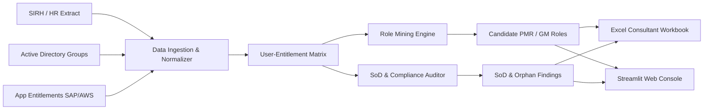

# 🛡️ IAM / IGA Role Mining & Security Audit Toolkit

[](https://github.com/vvazzim/iam-role-mining/actions)
[](https://www.python.org/)
[](https://opensource.org/licenses/MIT)
[]()
[]()

> **Enterprise Identity Governance & Administration (IGA) toolkit for Role Mining, Entitlement Analytics, Segregation of Duties (SoD) verification, and Orphan Account detection.**

---

## 📌 Executive Overview

In large enterprise environments (CAC 40, multinational infrastructures), identity matrices suffer from **privilege creep**, **atypical access accumulation**, and **unrevoked permissions for departed employees (leavers)**. 

This repository implements an automated, audit-ready **Role Mining & IGA Analytics Engine** designed to:
1. **Consolidate heterogeneous access sources** (HR database, Active Directory security groups, SAP ERP authorizations, AWS cloud roles).
2. **Mine candidate Business Roles** (**PMR** - *Profils Métiers Référentiels* / **GM** - *Groupes Métiers*) using statistical frequency and bottom-up clustering.
3. **Audit Segregation of Duties (SoD)** against toxic permission combinations (e.g., *Invoice Creation* + *Payment Approval*).
4. **Detect Orphan Accounts & Leavers** still active in Active Directory after HR contract termination.
5. **Generate consultant-grade Excel deliverables** formatted for business workshops and Pivot Tables (Tableaux Croisés Dynamiques - TCD).

---

## 🏗️ Architecture & Data Flow



---

## 🚀 Key Features

### 1. Modélisation de Rôles & Role Mining (RBAC / PMR / GM)
- **Bottom-Up Discovery :** Analyse fréquentielle des distributions d'accès parmi les salariés actifs d'un même département.
- **Top-Down Alignment :** Validation organisationnelle basée sur les attributs RH (Département, Intitulé de poste).
- **Calcul de métriques IGA :**
  - **Taux de couverture du rôle** (% des membres et des permissions couverts).
  - **Réduction de la complexité** (% d'assignations directes simplifiées en un rôle unifié).
  - **Analyse des droits résiduels (atypiques)** nécessitant une dérogation managériale.

### 2. Audit de Conformité & Ségrégation des Tâches (SoD)
- **Matrice de combinaisons toxiques :** Détection automatique des cumuls de privilèges incompatibles (fraude financière, création/approbation de commandes, injection de code sans revue).
- **Catégorisation des risques :** Niveaux de criticité `CRITICAL`, `HIGH`, `MEDIUM` avec préconisations de remédiation conformes aux standards d'audit.

### 3. Contrôle du Cycle de Vie des Identités (Joiner / Mover / Leaver)
- **Comptes Orphelins (Leavers) :** Détection des comptes actifs dans l'annuaire Active Directory ou les applications alors que le statut SIRH est `TERMINATED`.
- **Privilege Creep (Movers) :** Identification des salariés ayant changé de département tout en conservant les habilitations de leur ancien poste.
- **Comptes à privilèges excessifs :** Repérage des comptes non-IT détenant des privilèges d'administration système (`GG_SEC_DOMAIN_ADMINS`, `AWS_PROD_ADMIN`).

### 4. Livrables pour Ateliers Métiers & Audit
- **Classeur Excel multi-onglets stylisé (`.xlsx`) :**
  - `Synthese_Executive` : Tableau de bord des KPIs d'accès pour comités de direction / RSSI.
  - `Modeles_Roles_PMR` : Fiches formelles des rôles candidats (PMR) et paniers de droits associés.
  - `Matrice_Habilitations_TCD` : Données dénormalisées pré-formatées pour Tableaux Croisés Dynamiques (TCD).
  - `Violations_SoD` : Liste nominative des conflits de pouvoirs avec plan d'action.
  - `Orphelins_et_Derives` : Comptes à révoquer d'urgence en revue de sécurité.

---

## ⚡ Quickstart

### 1. Installation

```bash
git clone https://github.com/vvazzim/iam-role-mining.git
cd iam-role-mining
pip install -e .[dev]
```

### 2. Lancer l'analyse complète en ligne de commande (CLI)

```bash
python -m iam_role_mining.cli run-all
```

**Sortie console :**
```text
================================================================================
 [IAM / IGA] ROLE MINING & AUDIT ENGINE --- DÉMARRAGE DE L'ANALYSE
================================================================================
[1/4] Génération des jeux de données d'accès d'entreprise...
 -> 120 identités créées (SIRH)
 -> 406 adhésions de groupes Active Directory
 -> 293 habilitations applicatives (SAP, AWS, Salesforce, etc.)
 -> 3 règles de séparation des tâches (SoD) configurées

[2/4] Consolidation de la matrice Utilisateur x Habilitations...
 -> Matrice binaire construite : dimension (117, 31)

[3/4] Exécution de l'algorithme de Role Mining (PMR - Profils Métiers)...
  [*] PMR_FINANCE : 5 habilitations | 20 membres couverts (76.9% réduction complexité)
  [*] PMR_ENGINEERING : 7 habilitations | 15 membres couverts (86.1% réduction complexité)
  ...

[4/4] Exécution de l'Audit de Sécurité & Conformité IGA...
  [!] 16 Violations de Séparation des Tâches (SoD)
  [!] 5 Comptes Orphelins (Salariés partis non déprovisionnés)

[SUCCÈS] Classeur Excel d'audit généré : data/output/role_mining_audit_report.xlsx
================================================================================
```

### 3. Lancer la Console Web Interactive (Streamlit)

```bash
streamlit run app.py
```

Accédez à `http://localhost:8501` pour explorer les matrices d'accès, filtrer par département, inspecter les violations SoD et télécharger le rapport Excel en 1 clic.

---

## 🧪 Tests & Qualité de Code

Le projet est testé unitairement avec `pytest` et respecte les normes de typage strict :

```bash
pytest --cov=iam_role_mining tests/ -v
```

```text
============================= test session starts =============================
tests/test_audit.py::test_iam_audit_engine PASSED                        [ 20%]
tests/test_data_generator.py::test_generate_enterprise_iam_data PASSED   [ 40%]
tests/test_exporter.py::test_excel_export PASSED                         [ 60%]
tests/test_ingestion.py::test_iam_data_store PASSED                      [ 80%]
tests/test_miner.py::test_role_mining_engine PASSED                      [100%]
============================== 5 passed in 1.2s ===============================
```

---

## 📂 Structure du Répertoire

```text
iam-role-mining/
├── .github/workflows/ci.yml       # Pipeline CI GitHub Actions automatique
├── data/
│   ├── synthetic/                 # Données sources (SIRH, AD, Apps, SoD)
│   └── output/                    # Rapports générés (role_mining_audit_report.xlsx)
├── src/iam_role_mining/
│   ├── __init__.py
│   ├── models.py                  # Schémas de données (Identity, Role, SoDRule, Finding)
│   ├── data_generator.py          # Générateur d'identités d'entreprise & anomalies
│   ├── ingestion.py               # Consolidation et matrice Utilisateur x Droits
│   ├── miner.py                   # Algorithme de Role Mining (PMR / GM)
│   ├── audit.py                   # Moteur d'audit SoD, orphelins et privilèges
│   ├── exporter.py                # Moteur d'exportation Excel openpyxl stylisé
│   └── cli.py                     # Interface ligne de commande
├── tests/                         # Suite de tests unitaires et d'intégration
├── app.py                         # Console de visualisation Streamlit
├── pyproject.toml                 # Définition du package et dépendances
└── README.md                      # Documentation d'ingénierie et d'audit
```

---

## 👤 Auteur

**Wassim CHIKHI**  
*Consultant Profilage IAM / IGA & Ingénieur Données*  
- Portfolio : [chikhiwassim.netlify.app](https://chikhiwassim.netlify.app)  
- GitHub : [@vvazzim](https://github.com/vvazzim)  
- LinkedIn : [wassim-chikhi](https://www.linkedin.com/in/wassim-chikhi/)  
- Email : `chikhimedwassim@gmail.com`
